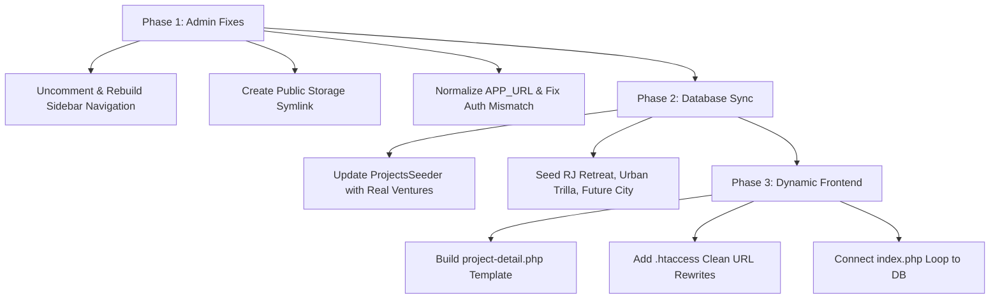

# Paanchajanya Realty — Technical Audit & System Remediation Report

**Date:** October 2026  
**Target Repository:** `annemchaitanyakumar/realestate`  
**Application Stack:** Dual Architecture (Native PHP 8.3 Public Site + Laravel 12 Livewire/Tailwind Admin Portal + MySQL 8.0)  
**Document Classification:** System Diagnostic & Remediation Architecture

---

## Executive Summary

A comprehensive architectural and functional audit of the Paanchajanya Realty web platform identified **7 critical issues** spanning frontend code bloat, database disconnects, broken admin navigation, media storage misconfiguration, and routing/authentication errors.

Most critically, the project currently suffers from an **architectural disconnect**: while the backend possesses a complete Laravel 12 CMS for project management, the frontend relies on static, hardcoded HTML files. Adding 20 ventures under the current design would require authoring **~36,000 lines of duplicated code**, rendering non-technical administrative management impossible.

This document outlines each issue, its root cause and business impact, and provides a clear, step-by-step remediation plan.

---

## Summary of Diagnostic Findings

| ID | Issue Title | Severity | Affected Area | Impact |
| :--- | :--- | :--- | :--- | :--- |
| **SEC-01** | **Hardcoded Static Projects vs. Empty Database** | **Critical** | Frontend (`index.php`, `project.php`) & Database | ~36,000 lines of duplicate code for 20 projects; no dynamic CMS |
| **NAV-02** | **Disabled Admin Sidebar Navigation for Projects** | **High** | Admin Blade Views (`components/admin-layout`) | Admins cannot access project management or creation forms |
| **MED-03** | **Missing Public Storage Symlink (`storage:link`)** | **High** | Media Pipeline (`admin/public/storage`) | Uploaded project and gallery images return 404 Not Found |
| **RTE-04** | **URL Route Prefix Duplication (`/admin/admin/`) & Port Conflict** | **High** | Laravel Routing & Environment Config | 404 errors on local dev; malformed URLs across admin routes |
| **AUTH-05**| **Administrator Login Domain Mismatch** | **Medium** | Database Seeders (`RolesAndAdminSeeder`) | Team locked out when entering corporate email `@paanchajanya.com` |
| **UI-06**  | **Legacy Industrial Placeholders in Venture Forms** | **Low** | Admin Forms (`projects-form.blade.php`) | Form placeholders show road/civil terms instead of real estate |
| **LEAD-07**| **Fragmented Multi-Table Lead Ingestion Pipeline** | **Medium** | Database Schemas & API Handlers | Leads split across 3 separate tables without unified view |

---

## Detailed Diagnostic Findings & Remediation Plans

---

### Issue 1: Hardcoded Static Projects vs. Empty Database (Architectural Disconnect)

#### 1. Description & Root Cause
* **Frontend:** The homepage (`index.php`) currently renders projects via static, hardcoded HTML `<article class="lp-project-card">` cards.
* **Landing Pages:** Dedicated project pages are completely independent, massive ~1,750-line static dumps:
  - RJ Retreat: `projects/rj-retreat/index.php` (1,751 lines)
  - Urban Trilla: `project.php` (1,755 lines)
  - Future City: No landing page exists at all.
* **Backend:** The Laravel database table `projects` is completely empty (0 records). The backend and frontend are entirely decoupled.

#### 2. Business Impact
* Adding 20 projects under this architecture requires writing and maintaining **~36,000 lines of repetitive code**.
* Global layout changes (phone numbers, header menus, footer copyright, analytics tracking) require manually modifying every single project file.
* Projects created by administrators in the backend panel never appear on the public website.

#### 3. How We Are Going to Fix It
1. **Develop a Dynamic Single-Page Template (`project-detail.php`):**
   - Create a single ~200-line PHP template that accepts a URL slug parameter: `project-detail.php?slug={slug}`.
   - Fetch the project record dynamically via PDO: `SELECT * FROM projects WHERE slug = ? AND is_active = 1`.
   - Populate page title, metadata, hero banner, gallery images, amenities list, location highlights, and enquiry forms dynamically from the database.
2. **Configure Clean URLs via `.htaccess`:**
   - Add rewrite rule: `RewriteRule ^project/([^/]+)/?$ project-detail.php?slug=$1 [L,QSA]`.
3. **Connect the Homepage (`index.php`) to the Database:**
   - Replace static cards with a dynamic PDO loop:
     ```php
     $stmt = $pdo->query("SELECT * FROM projects WHERE is_active = 1 ORDER BY `order` ASC, id DESC");
     $projects = $stmt->fetchAll(PDO::FETCH_ASSOC);
     ```
   - Automatically render cards from database records with links to `/project/{slug}`.
4. **Seed Database with Core Ventures:**
   - Insert *DRR Premium County (RJ Retreat)*, *Urban Trilla Living*, and *Future City Enclave* into the `projects` table with complete specifications and imagery.

---

### Issue 2: Disabled Admin Sidebar Navigation for Projects Module

#### 1. Description & Root Cause
In `admin/resources/views/components/admin-layout.blade.php`, the link to the Projects module was commented out with HTML comments:
```blade
<!-- @if(auth()->user()->can('projects.view'))
<a href="{{ route('admin.projects.index') }}" class="sidebar-link ...">
    <i class="fas fa-project-diagram w-5"></i>
    <span>Projects</span>
</a>
@endif -->
```
Under the "Projects" section of the sidebar, only "RJ Retreat." (which links to the campaign enquiry tracker `/admin/rj-retreat`) was visible.

#### 2. Business Impact
Administrators logging into the dashboard cannot discover or navigate to project creation, editing, or catalog management from the sidebar.

#### 3. How We Are Going to Fix It
1. **Uncomment and Reorganize Projects Navigation:**
   - Place a dedicated **Projects & Ventures** group in `components/admin-layout.blade.php` and `admin/layout.blade.php`.
   - Add **All Projects** (`route('admin.projects.index')`) with a dynamic counter badge showing total projects.
   - Add **Add New Project** (`route('admin.projects.create')`) as a direct creation shortcut.
   - Retain **RJ Retreat (Leads)** (`route('admin.drr.index')`) with pending enquiry count badges.
2. **Dashboard Quick Actions:**
   - Add **All Projects** and **Add Project** quick action buttons to `dashboard.blade.php`.
   - Activate the "Total Projects" statistic counter card on the dashboard.

---

### Issue 3: Missing Public Storage Symlink (`storage:link`)

#### 1. Description & Root Cause
In Laravel, uploaded files are stored in `admin/storage/app/public/` to prevent direct public file execution. A filesystem junction/symlink at `admin/public/storage` is required to serve these assets over HTTP. This symlink was never created.

#### 2. Business Impact
Any project featured image or multi-image gallery upload saved via the admin controller results in broken images (HTTP 404) when viewed in a web browser.

#### 3. How We Are Going to Fix It
1. Run `php artisan storage:link` from the `admin` directory.
2. Verify that `admin/public/storage` properly links to `admin/storage/app/public`.
3. Standardize image retrieval in Blade views using `asset('storage/' . $project->image)`.

---

### Issue 4: URL Route Prefix Duplication (`/admin/admin/`) & Port Conflict

#### 1. Description & Root Cause
Two interrelated factors cause HTTP 404 errors during development:
1. **Environment Config:** `admin/.env` defined `APP_URL=https://paanchajanyarealty.com/admin` (with `/admin` at the end). When combined with route group prefixing `Route::prefix('admin')` in `routes/web.php`, Laravel's `route()` helper outputs URLs containing duplicate prefixes: `.../admin/admin/projects/create`.
2. **Port Mismatch:** The project runs two separate servers locally:
   - Port 8000: Native PHP server (`php -S localhost:8000`) serving the public website. Does **not** parse `.htaccess` rewrite rules.
   - Port 8080: Laravel Artisan server (`php artisan serve --port=8080`) serving the admin panel.
   Requests to `http://localhost:8000/admin/...` hit the public server, which cannot route Laravel requests and returns a PHP built-in 404 error.

#### 2. Business Impact
Users visiting admin URLs on the wrong port or following generated links receive immediate 404 "Resource Not Found" errors.

#### 3. How We Are Going to Fix It
1. **Normalize `APP_URL`:**
   - Update `admin/.env` to `APP_URL=http://localhost:8080` for local development (and `https://paanchajanyarealty.com` without `/admin` for production).
2. **Clear Configuration Cache:**
   - Run `php artisan config:clear` and `php artisan route:clear`.
3. **Local Dev Documentation:**
   - Clearly document that Public Website runs on `http://localhost:8000` and Admin runs on `http://localhost:8080/admin`.

---

### Issue 5: Administrator Login Domain Mismatch

#### 1. Description & Root Cause
In `admin/database/seeders/RolesAndAdminSeeder.php`, the default administrator was seeded with:
- Email: `admin@paanch.com`
- Password: `admin123`

When real administrators and stakeholders attempt to log into the panel, they naturally type their corporate domain email: **`admin@paanchajanya.com`**. This triggers an authentication failure: *"The provided credentials do not match our records."*

#### 2. Business Impact
Administrative staff cannot log into the control panel without consulting technical team members for the exact seed email.

#### 3. How We Are Going to Fix It
1. Update user records so that **`admin@paanchajanya.com`** is registered and active with full Administrator role and password `admin123`.
2. Retain `admin@paanch.com` as a secondary fallback.
3. Update `RolesAndAdminSeeder.php` to seed the proper corporate domain by default.

---

### Issue 6: Legacy Industrial Placeholders in Venture Forms

#### 1. Description & Root Cause
The project form (`projects-form.blade.php`) contained generic contract placeholders originating from an industrial construction starter template:
- Category placeholder: `"e.g., Infrastructure, Building, Road"`
- Value description: `"Project Value (Rs. In Lakhs)"`

#### 2. Business Impact
Content creators and real estate marketing staff are confused by civil engineering terminology instead of real estate terminology.

#### 3. How We Are Going to Fix It
1. Update field labels and placeholders to real estate terms:
   - Change Category to *"Category / Venture Type"*.
   - Add an HTML5 `<datalist>` providing standard Paanchajanya categories: *Open Plots, Villa Plots, Luxury Apartments, Residential Ventures, Commercial Plots, Farm Lands*.
2. Add helper tooltips for square yard plot sizing and unit configurations.

---

### Issue 7: Fragmented Multi-Table Lead Ingestion Pipeline

#### 1. Description & Root Cause
The application currently captures customer inquiries across **3 separate database tables** without a consolidated management view:
1. `contact_submissions`: General website inquiries from `index.php` and `contactus.php`.
2. `drr_enquiries`: Dedicated plot inquiries from the RJ Retreat microsite.
3. `drr_brochures`: Users who submitted phone numbers to download the RJ Retreat brochure.

#### 2. Business Impact
Sales agents have to inspect multiple admin tabs to collect leads, creating a risk that customer leads sit unattended.

#### 3. How We Are Going to Fix It
1. Build a unified **Leads Summary Widget** on the admin dashboard that aggregates total leads across `contact_submissions`, `drr_enquiries`, and `drr_brochures`.
2. Maintain table schemas to avoid breaking existing tracking and reporting, while offering a consolidated export option.

---

## Action Plan & Implementation Roadmap



### Execution Steps
1. **Fix Admin Interface:** Ensure full accessibility, proper permissions, storage links, and correct authentication credentials.
2. **Database Normalization:** Populate real estate projects in the `projects` table with descriptions, images, and categories.
3. **Dynamic Template Development:** Create `project-detail.php` so all future projects automatically have full landing pages.
4. **Homepage Dynamic Wiring:** Update `index.php` to dynamically read from the `projects` table while preserving custom campaign pages where needed.

---

## Conclusion

By executing this remediation plan, Paanchajanya Realty transitions from an unmaintainable, static 36,000-line multi-file structure into a modern, centralized dynamic CMS where administrators can launch new ventures in seconds without developer intervention.
